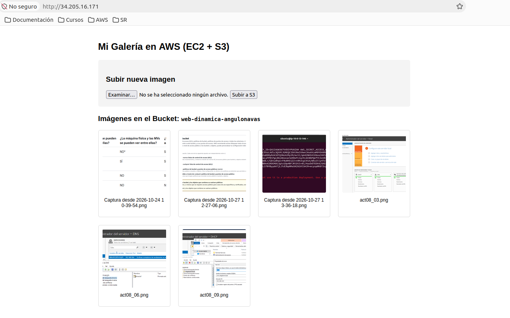

# Actividad 12. Proyecto web dinámica

El proyecto consiste en crear una aplicación web que permita subir imágenes a un repositorio y mostrar un listado con todas las imágenes que hemos ido subiendo. 



Para crear la aplicación vamos a tener que construir una arquitectura formada por los siguientes servicios de AWS:

- **VPC** → para crear la estructura de red y subredes.
- **S3** → para crear el repositorio en el que almacenaremos las imágenes.
- **EC2** → para crear la instancia con el servidor que va a alojar al servidor web.

!!! note "Realizaremos el proyecto en tres fases"

## Fase 1. Creación de la infraestructura de red. ##

El objetivo de esta fase es dejar el terreno preparado, creando una red aislada y segura con salida a Internet. Para hacerlo de la forma más limpia y didáctica, utilizaremos el asistente visual de AWS que automatiza la creación y el enrutamiento.

### Paso 1.1: Crear la VPC y las Subredes. ###

1.- Crea una VPC en la ubicación `us-east-1`

2.- De nombre indica `Proyecto-web-dinamica`

3.- Crea una `VPC y más`.

3.- Crea sólo una subred pública

### Paso 1.2: Habilitar la auto-asignación de IPs públicas. ###

1.- Por defecto, las subredes creadas a mano no asignan una IP pública a los servidores. Debemos activar la subred creada anteriormente para que la máquina EC2 que creemos en la Fase 3 tenga internet:

   - Para ello habilita la casilla `Habilitar la dirección publica de autoasignación IPv4`

### Paso 1.3: Verificar el enrutamiento a Internet ###

Para seguir con el proyecto asegúrate que la tabla de enrutamiento asignado a tu VPC tiene configurada acceso completo a local y una puerta de enlace. Concretamente asegúrate de encontrar estas dos lineas:

- Una ruta local **10.0.0.0/16 → local**.
- Una ruta de salida total **0.0.0.0/0** apuntando a un **igw-xxxxxxxx** (Internet Gateway).


## Fase 2. Configuración del Almacenamiento (S3) ##

El objetivo de esta fase es crear el contenedor digital o bucket donde se guardarán las imágenes de la aplicación. En AWS Academy, debido a que **no podemos usar roles de IAM en AWS Academy**, configuraremos el bucket para que permita que las imágenes se puedan ver públicamente mediante enlaces directos en el navegador.

### Paso 2.1: Crear el Bucket de S3 ###

- Crea un bucket con nombre `bucket-web-dinamica-tuUsuario` 

!!! Warning "Nombre único"
    Recuerda que el nombre del bucket debe ser único a nivel mundial.

- Asegúrate de que se crea en la zona `us-east-1` y tienes habilitadas las `listas ACL`
- El bucket tiene que estar asignado al propietario preferido.

### Paso 2.2: Permitir el Acceso Público ###

Por seguridad, AWS bloquea todo acceso público a los buckets por defecto. Como este proyecto simula una galería de imágenes en una web abierta, deberás desactivar este bloqueo.

### Paso 2.3: Crear el Bucket y añadir la política de lectura ###

Es el momento de añadir las políticas de lectura. Para ello configura los permisos de políticas del bucket con el siguiente código json:

```
{
    "Version": "2012-10-17",
    "Statement": [
        {
            "Sid": "PublicReadGetObject",
            "Effect": "Allow",
            "Principal": "*",
            "Action": "s3:GetObject",
            "Resource": "arn:aws:s3:::web-dinamica-angulonavas/*"
        }
    ]
}
```

!!! warning "Recuerda"
    Debes cambiar el nombre del bucket del código anterior por el tuyo


## 💻 Fase 3: Cómputo y Despliegue en EC2 ##

Llegamos a la última etapa. Con la red segura y el almacenamiento configurado, es hora de levantar el servidor e instalar la aplicación para ver el proyecto en funcionamiento.

El objetivo de esta fase es lanzar una máquina virtual con Ubuntu Server, configurar su cortafuegos (Security Group), inyectar el código en Python que preparamos y conectarlo todo.

### Paso 3.1: Lanzar la Instancia EC2 Ubuntu ###

Crea una instancia con las siguientes características:

- Nombre: `servidor-web-dinamca`
- `Server 24.04 LTS` de tipo `t2.micro`
- Asigna a la instancia la VPC creada anteriormente. 
- Debes permitir la asignación de una IP pública.

#### Crea un grupo de seguridad para la instancia con las siguientes características ####

- Regla 1 (SSH): Type: SSH | Port: 22 | Accesible desde cualquier sitio.
- Regla 2 (HTTP): Type: HTTP | Port: 80 | Accesible desde cualquier sitio (0.0.0.0/0)
   
!!! note "Regla HTTP" 
    Esta regla es vital para que los usuarios puedan abrir la web.

### Paso 3.2: Conectarse al servidor por SSH ###

Conéctate a tu servidor Ubuntu por SSH desde una terminal abierta en tu equipo local.

### Paso 3.3: Preparar el entorno y crear el código ###

1.- En primer lugar instala el servidor python que te va a permitir crear tu servidor web:
```bash
sudo apt update
sudo apt install python3-pip -y
```

2.- Instala las librerías necesarias:

- Instalar el soporte de entornos virtuales de Python en Ubuntu 
```bash
sudo apt install python3-venv -y
```

- Crear un entorno virtual llamado 'venv' en la carpeta actual
```bash
python3 -m venv venv
```

- Activar el entorno virtual (verás que cambia el prompt de tu terminal)
```bash
source venv/bin/activate
```

- Instalar las librerías limpiamente sin 'sudo' ni flags extra
```bash
pip install flask boto3
```

3.- Crea el archivo que contendrá el código de la aplicación y llámalo `app.py`

4.- Pega el siguiente código en su interior:
``` py title="app.py"
import os
from flask import Flask, request, redirect, render_template_string
import boto3

app = Flask(__name__)

# --- CONFIGURACIÓN ---
# El alumno debe escribir aquí el nombre exacto de su Bucket de S3
BUCKET_NAME = "web-dinamica-angulonavas"
REGION = "us-east-1"
# ---------------------

s3 = boto3.client('s3', region_name=REGION)

# Plantilla HTML integrada para no necesitar archivos extra
HTML_TEMPLATE = """
<!DOCTYPE html>
<html>
<head>
    <title>Galeria AWS Academy</title>
    <style>
        body { font-family: Arial, sans-serif; max-width: 800px; margin: 0 auto; padding: 20px; }
        .upload-box { background: #f4f4f4; padding: 20px; border-radius: 5px; margin-bottom: 20px; }
        .gallery { display: grid; grid-template-columns: repeat(auto-fill, minmax(150px, 1fr)); gap: 20px; } /* <-- Cambia 150px por 20px */
        .item { text-align: center; border: 1px solid #ddd; padding: 10px; border-radius: 5px; background: white; }
        img { width: 100%; height: 150px; object-fit: cover; border-radius: 3px; display: block; } /* <-- Añade un alto fijo y display block */
    </style>
</head>
<body>
    <h2>Mi Galería en AWS (EC2 + S3)</h2>
    
    <div class="upload-box">
        <h3>Subir nueva imagen</h3>
        <form method="post" action="/upload" enctype="multipart/form-data">
            <input type="file" name="file" accept="image/*" required>
            <button type="submit">Subir a S3</button>
        </form>
    </div>

    <h3>Imágenes en el Bucket: <code>{{ bucket }}</code></h3>
    <div class="gallery">
        
            <div class="item">
                
                <p style="font-size: 12px; word-break: break-all;">{{ name }}</p>
            </div>
        
            <p>No hay imágenes en el bucket todavía.</p>
        
    </div>
</body>
</html>
"""

@app.route('/')
def index():
    images = []
    try:
        # Listar objetos del bucket
        response = s3.list_objects_v2(Bucket=BUCKET_NAME)
        if 'Contents' in response:
            for obj in response['Contents']:
                key = obj['Key']
                # Generar la URL pública directa del objeto en S3
                url = f"http://{BUCKET_NAME}.s3.us-east-1.amazonaws.com/{key}"
                images.append((url, key))
    except Exception as e:
        return f"Error al conectar con S3: {str(e)}. Revisa las credenciales de AWS Academy."

    return render_template_string(HTML_TEMPLATE, images=images, bucket=BUCKET_NAME)

@app.route('/upload', methods=['POST'])
def upload():
    file = request.files['file']
    if file:
        try:
            # Subir el archivo a S3 permitiendo lectura pública para poder mostrarlo
            s3.upload_fileobj(
                file, 
                BUCKET_NAME, 
                file.filename,
                ExtraArgs={'ACL': 'public-read', 'ContentType': file.content_type}
            )
        except Exception as e:
            return f"Error al subir: {str(e)}"
    return redirect('/')

if __name__ == '__main__':
    # Escucha en el puerto 80 para todo el mundo
    app.run(host='0.0.0.0', port=80)
```

5.- Instalación del paquete de conexión con AWS

Para poder conectar tu servidor con el cliente AWS es necesario obtener una serie de parámetros, los cuales se pueden obtener en el aparetado `AWS Details`de tu pantalla inicial del laboratorio:

- **aws_access_key_id**
- **aws_secret_access_key**
- **aws_session_token**

6.- Una vez localizados estos parámetros, ejecuta la siguiente sentencia en tu servidor:
```bash
sudo snap install aws-cli –classic
```

7.- Una vez configurado el acceso CLI es momento de poner en marcha tu servidor. Hay que ejecutarlo así porque estamos en versión Academy. Indica tus propios parámetros AWS en la configuración de la siguiente sentencia ubicándolos entre comillas:
```bash
sudo AWS_ACCESS_KEY_ID="xxxxxxxxxxx" AWS_SECRET_ACCESS_KEY="xxxxxxxxxxxxxxxxxxxx" AWS_SESSION_TOKEN="xxxxxxxxxxxxxx" ./venv/bin/python3 app.py
```

8.- Pon a prueba su servidor conectando al mismo a través de un navegador. Deberás conectar utilizando la IP de tu servidor: `http://54.85.23.90` 

!!! warning "Recuerda liberar los recursos"
    
    - Libera la instancia EC2
    - Libera el bucket S3.
    - Libera la estructura de red VPC.


